# Zashterminal

<p align="center">
  
</p>

<p align="center">
  <b>A modern GTK4 terminal for developers, infrastructure, and system administration</b>
</p>

<p align="center">
  <a href="LICENSE"></a>
  <a href="https://www.gtk.org/"></a>
  <a href="https://gnome.pages.gitlab.gnome.org/libadwaita/"></a>
  <a href="https://ko-fi.com/leoberbert"></a>
</p>

Zashterminal combines a VTE terminal with session management, an integrated file manager, optional AI assistance, and workflow tools — built on GTK4 and libadwaita for a native Linux desktop experience.

**Supported installs:** Arch/Manjaro (AUR), Debian/Ubuntu, Fedora, openSUSE, Gentoo, NixOS. WSL (Ubuntu) is experimental.

---

## Table of contents

- [Gallery](#gallery)
- [Features](#features)
- [Imports & PAM](#imports--pam)
- [Requirements](#requirements)
- [Installation](#installation)
- [Usage](#usage)
- [Configuration](#configuration)
- [Contributing](#contributing)
- [License & support](#license--support)

---

## Gallery

Screenshots live in [`docs/gallery/`](docs/gallery/) (regenerate with `PYTHONPATH=src python3 scripts/capture_gallery.py`).

### Home base

Main window with a live shell — sessions sidebar, tabs, and header actions for search, file manager, and AI.

<p align="center">
  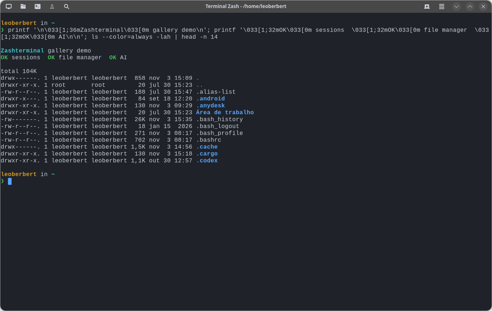
</p>

### Multi-pane ops layout

Split horizontally and vertically to watch logs, metrics, and an interactive shell in one tab.

<p align="center">
  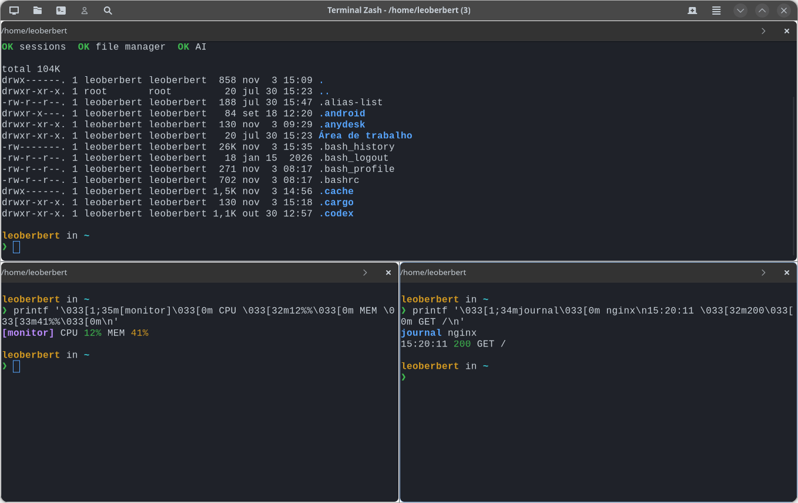
</p>

### Integrated file manager

Browse local (and remote/SFTP) directories under the terminal — size, permissions, owner, recursive filter.

<p align="center">
  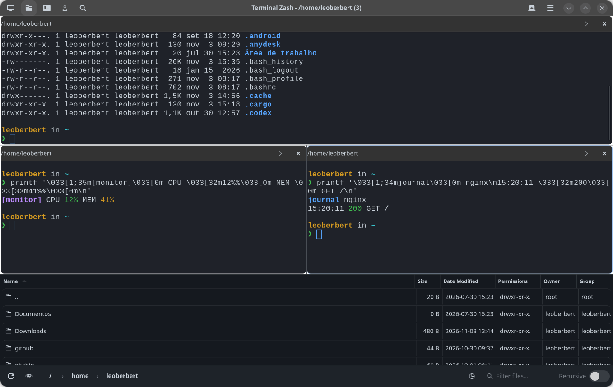
</p>

### Search across all tabs

Find bar with **Case sensitive**, **Regex**, and **All tabs** — Next/Previous jumps between matching panes.

<p align="center">
  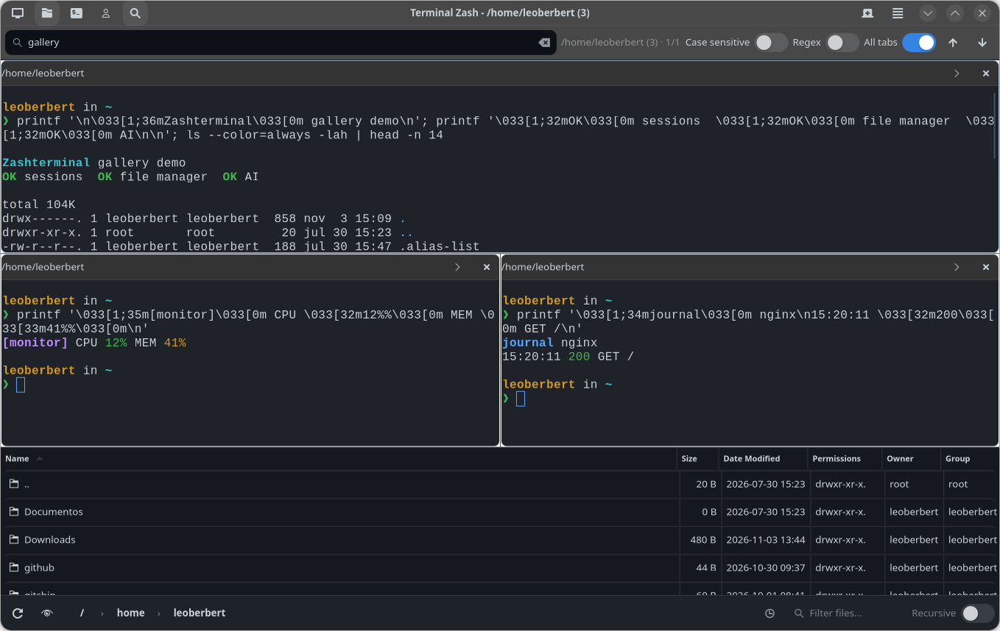
</p>

### Broadcast a command

Type once and send the same command to selected tabs/panes (with optional remembered selection).

<p align="center">
  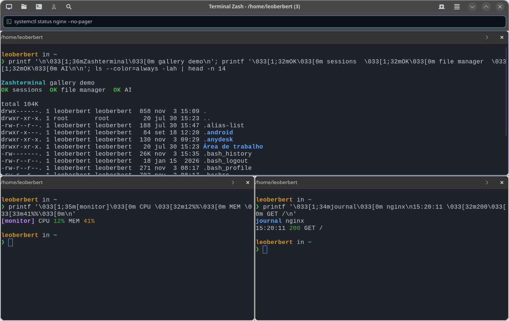
</p>

### Color schemes & wallpaper palettes

Thirty built-in schemes plus Pywal wallpaper detection — preview before you apply.

<p align="center">
  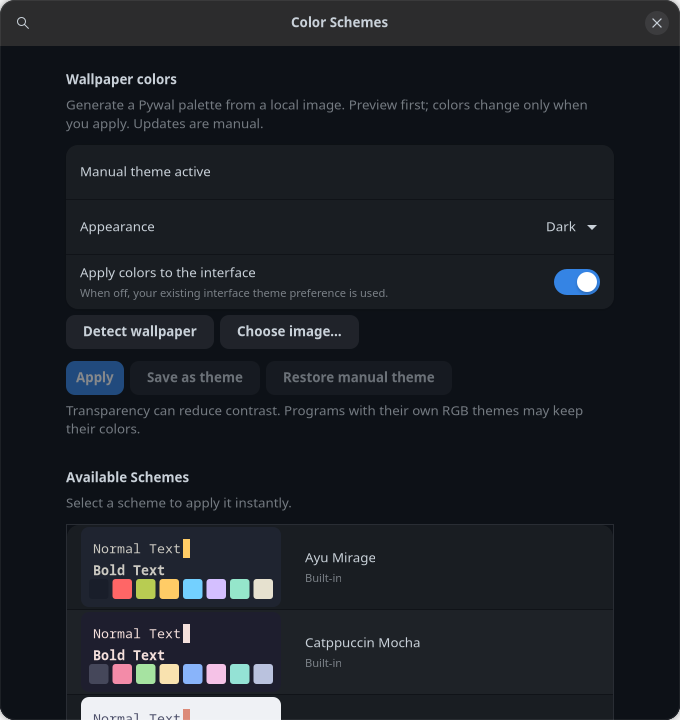
</p>

### Preferences

Appearance, terminal behavior, profiles/backups, and advanced VTE options in a searchable Preferences window.

Background blur is rendered live by the compositor: it follows window movement, resizing and changes behind the terminal without screenshots, hidden windows or capture permissions. Enable **Background Blur** and raise **Terminal Transparency** to see the effect. Transparency and blur strength are separate controls.

Toggling blur takes effect immediately, including while Preferences is focused and the terminal is idle; changing transparency or moving the window is not required.

On KDE Wayland, the optional **Zashterminal Per-Window Blur** native effect enables **Blur Strength** levels **1–15** in Preferences. It changes the GPU sampling kernel for the requested terminal surface only; it does not change the desktop's blur strength or blur other applications. Requests are identified by the caller's authenticated PID and native surface ID, not the window title.

Strength changes affect the window whose Preferences you opened; other open terminal windows keep their own values. The last selected strength is saved as the default for newly created windows.

The native effect currently targets **Fedora 44 x86_64, KWin 6.8.2 and Qt 6.11.2**. Build it with rootless Podman and network access; no compiler or development packages are installed on the host:

```bash
bash native/kwin-blur/build.sh --stage
bash native/kwin-blur/build.sh --help
```

`--stage` builds into the user cache without changing the running desktop. The helper's `--help` shows how to expose the staged plugin to a **new nested KWin** through `QT_PLUGIN_PATH` for isolated validation. After validation, install it into the existing system plugin directory with administrator authentication:

```bash
bash native/kwin-blur/build.sh --install-system
```

Installation copies only the plugin; it does not restart KWin or change its global settings. Restart the terminal application to discover and load the effect. KWin's native API is private: rebuild and revalidate the effect after KWin/Qt upgrades; the helper rejects mismatched versions.

Without the extension, standard Wayland background effects, older KDE Wayland blur, and the X11 KDE blur hint remain available when advertised by the compositor. Their strength belongs to the desktop, so the independent-strength slider is disabled with installation guidance. On unsupported compositors the blur switch is disabled too. Existing nonzero screenshot-blur amounts migrate to enabled; transparency is preserved.

<p align="center">
  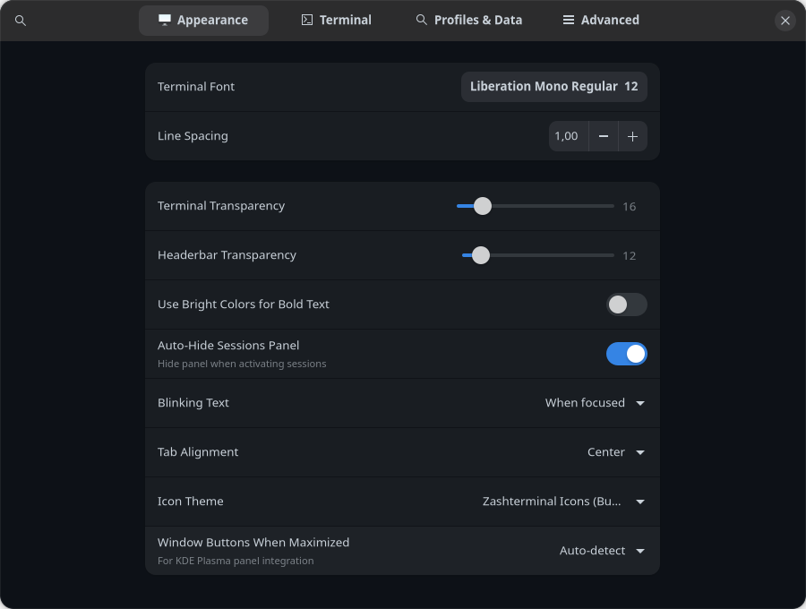
</p>

### AI assistant

Optional multi-provider AI (Groq, Gemini, OpenRouter, Ollama / LM Studio). Only text you explicitly send is shared.

<p align="center">
  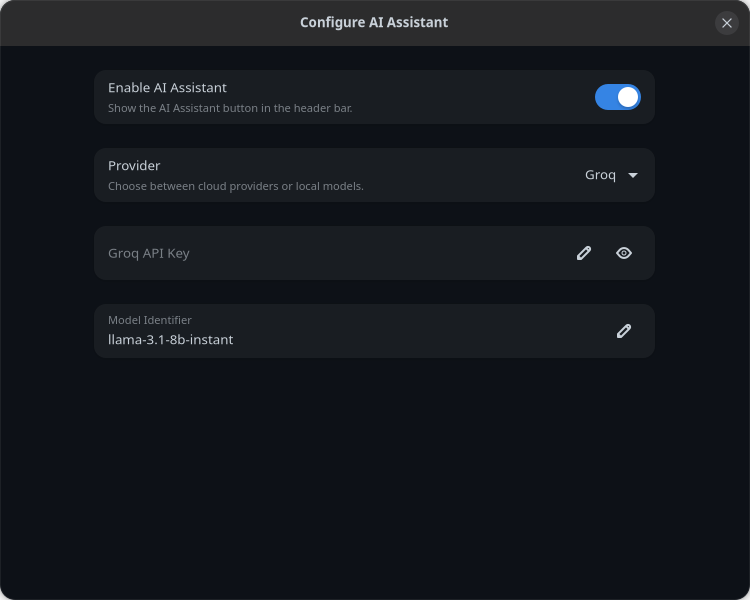
</p>

### Output highlighting

Terminal colors, output rules, and command-specific highlighting for ops-friendly readability.

<p align="center">
  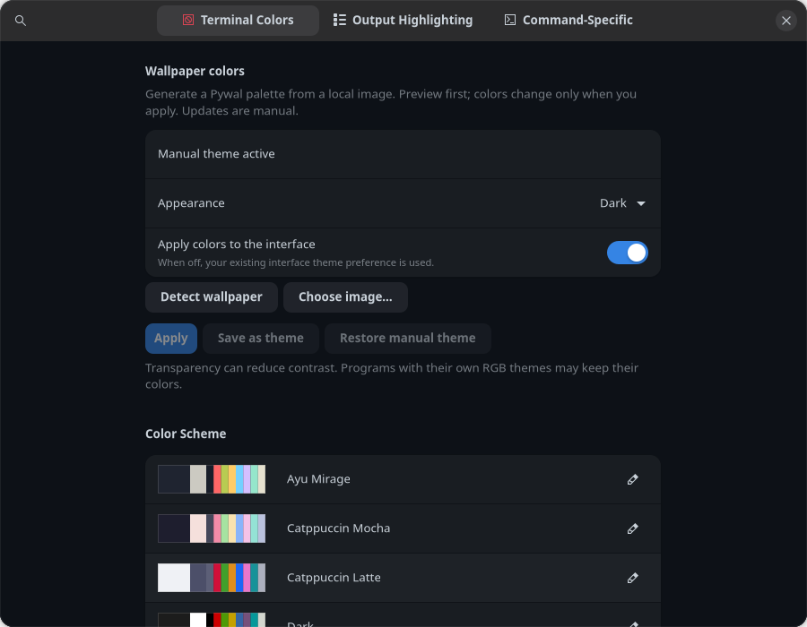
</p>

### Session editor

SSH/local sessions with folders, auth, post-login commands, forwards, and optional per-session highlight overrides.

<p align="center">
  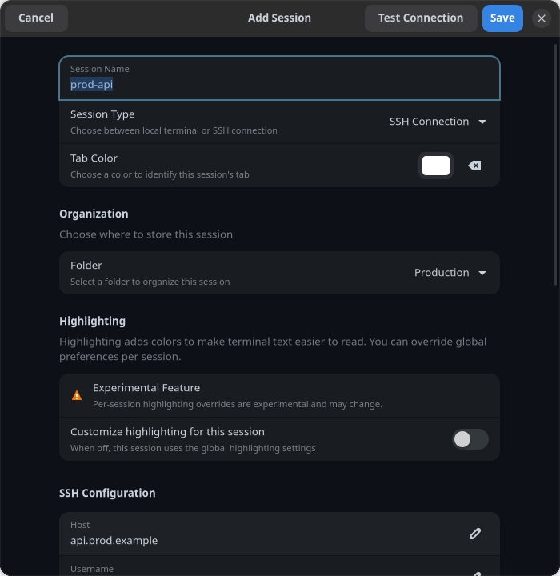
</p>

### Keyboard shortcuts

Browse and customize accelerators from the shortcuts dialog.

<p align="center">
  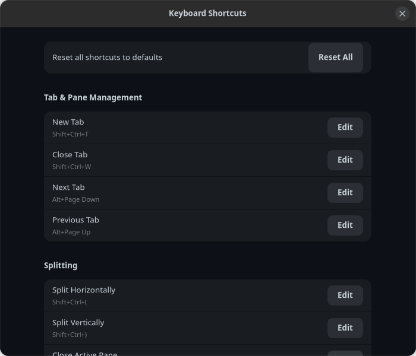
</p>

### Command manager

Reusable command snippets with icons and forms — insert, run, or open as a dialog.

<p align="center">
  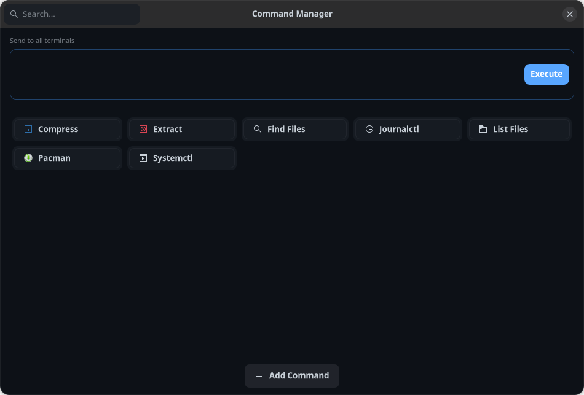
</p>

---

## Features

| Area | What you get |
|------|----------------|
| **Sessions** | Local, SSH, and SFTP sessions with folders, restore, and layouts |
| **Imports** | SecureCRT directory trees, PuTTY `.reg`/`.ini`, mRemoteNG `confCons.xml`, OpenSSH `~/.ssh/config` |
| **Layouts** | Horizontal/vertical splits; save and restore multi-pane setups |
| **File manager** | Local and remote browsing, drag-and-drop transfer, remote edit + upload on save |
| **Search** | In-terminal find with case/regex; **All tabs** scope jumps across panes |
| **Highlighting** | Output rules for 50+ commands; optional Pygments for `cat` / input |
| **AI (optional)** | Multi-provider chat, quick prompts, click-to-run snippets — selection only |
| **Broadcast** | Type once; run across selected tabs/panes |
| **Appearance** | 30 built-in schemes (default: GitHub Dark), transparency, shortcuts |

### Color schemes

Default: **GitHub Dark**. Also included: Ayu Mirage, Catppuccin (Mocha / Latte), Dracula, Everforest, Gruvbox, Horizon, Kanagawa, Material Ocean, Monokai, Moonfly, Night Owl, Nord, One Dark Pro, Oxocarbon, Palenight, Rosé Pine, Solarized, Tokyo Night, VS Code Dark+, System Default, and light variants.

Switch or customize from **Preferences → Terminal colors**.

---

## Imports & PAM

Bring sessions in from the main menu:

- **SecureCRT** — Sessions folder trees + **Password V2** (`02:<hex>`)
- **PuTTY** — exported `.reg` or portable `.ini` (SSH hosts, keys, local forwards; optional `/`-as-folders)
- **mRemoteNG** — `confCons.xml` SSH nodes (legacy / AES-GCM passwords; optional master password)
- **OpenSSH** — `~/.ssh/config` hosts synced on startup

Keyboard-interactive flows used with **Balabit / One Identity** privileged session gateways are supported.

One Identity (formerly Balabit) PAM docs: [Privileged Access Management](https://www.oneidentity.com/br-pt/privileged-access-management/)

---

## Requirements

| Component | Notes |
|-----------|--------|
| Python | 3.10+ |
| GTK / Adwaita | GTK4, libadwaita 1.0+ |
| VTE | VTE for GTK4 (`vte4` ≥ 0.76 recommended) |
| PyGObject, pycairo | GTK bindings |
| pycryptodomex | SecureCRT-compatible crypto |
| requests | AI API calls |
| pygments | Optional syntax highlighting |
| psutil, regex | Optional |

---

## Installation

### Arch / Manjaro

```bash
yay -S zashterminal   # or: paru -S zashterminal
```

Or system-wide via installer:

```bash
curl -fsSL https://raw.githubusercontent.com/leoberbert/zashterminal/refs/heads/main/install.sh | bash
```

### Debian / Ubuntu / Fedora / openSUSE

`install.sh` detects the distro, installs system packages, and places a venv under `/opt/zashterminal/venv`.

```bash
curl -fsSL https://raw.githubusercontent.com/leoberbert/zashterminal/refs/heads/main/install.sh | bash
```

### Gentoo

Same installer (`emerge`). It writes `package.use`, prefers the amd64 binhost when available (`GENTOO_USE_BINHOST=0` for source builds), installs `gsettings-desktop-schemas`, and puts `pycryptodomex` in the venv (Gentoo’s `pycryptodome` exposes `Crypto`, not `Cryptodome`).

```bash
curl -fsSL https://raw.githubusercontent.com/leoberbert/zashterminal/refs/heads/main/install.sh | bash
```

The launcher sets `GDK_BACKEND=x11` when GTK was built without Wayland but Distrobox still exports `WAYLAND_DISPLAY` / `GDK_BACKEND=wayland`.

### NixOS

Uses the project flake into the user profile. Enable flakes and ensure `git` is installed, then:

```bash
sudo nixos-rebuild switch
curl -fsSL https://raw.githubusercontent.com/leoberbert/zashterminal/refs/heads/main/install.sh | bash
```

```nix
nix.settings.experimental-features = [ "nix-command" "flakes" ];
environment.systemPackages = with pkgs; [ git ];
```

### WSL (experimental)

Tested on **Ubuntu 24.04 + WSLg**. Same `install.sh` flow as Debian/Ubuntu. For non-English locales, set `LANG` / `LC_ALL` and, if needed, `setxkbmap` in `~/.bashrc`, then restart WSL.

---

## Usage

```bash
zashterminal [options] [directory]
```

| Option | Description |
|--------|-------------|
| `-w, --working-directory DIR` | Initial working directory |
| `-e, -x, --execute COMMAND` | Run command on startup (remaining args included); **closes when the command exits** by default |
| `--close-after-execute` | Close after execute (default with `--execute`) |
| `--no-close-after-execute` | Keep the shell open after `--execute` |
| `--ssh [USER@]HOST` | Open an SSH session |
| `--new-window` | Force a new window |

```bash
zashterminal ~/projects
zashterminal -e htop
zashterminal --ssh user@server.example.com
zashterminal --no-close-after-execute -e "ls -la"
```

---

## Configuration

Files under `~/.config/zashterminal/`:

| Path | Purpose |
|------|---------|
| `settings.json` | Preferences, appearance, shortcuts, AI |
| `sessions.json` | Saved SSH/SFTP sessions and folders |
| `session_state.json` | Window / restore state |
| `layouts/` | Saved split layouts |
| `logs/` | Optional file logs |
| `backups/` | Encrypted backup archives |

Highlight rules ship in `data/highlights/` (docker, git, systemctl, kubectl, and more).

---

## Contributing

1. Fork the repository  
2. Create a branch (`git checkout -b feature/your-change`)  
3. Commit and push  
4. Open a pull request  

CI runs unit tests on Python 3.10–3.13 with coverage. Pull requests also trigger a [SonarQube Cloud](https://sonarcloud.io) scan when the repository secret `SONAR_TOKEN` is set (optional `SONAR_ORGANIZATION` / `SONAR_PROJECT_KEY`). See `sonar-project.properties`.

**Important:** in SonarQube Cloud → project → **Administration → Analysis Method**, disable **Automatic Analysis**. CI analysis and Automatic Analysis cannot run together.

Local checks:

```bash
python3 -m pip install -e ".[dev]"
PYTHONPATH=src python3 -m coverage run -m unittest discover -s tests -v
PYTHONPATH=src python3 -m coverage report
```

---

## License & support

Licensed under **GNU GPL v3 or later** — see [LICENSE](LICENSE).

If Zashterminal helps your workflow, support development on [Ko-fi](https://ko-fi.com/leoberbert).

**Contact:** [leo4berbert@gmail.com](mailto:leo4berbert@gmail.com) · [LinkedIn](https://linkedin.com/in/leoberbert)

**Thanks** to the GNOME, GTK, VTE, and Pygments communities.

---

<p align="center">
  <sub>Leonardo Berbert</sub>
</p>
